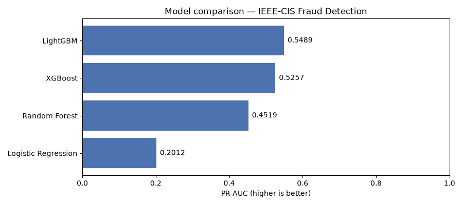
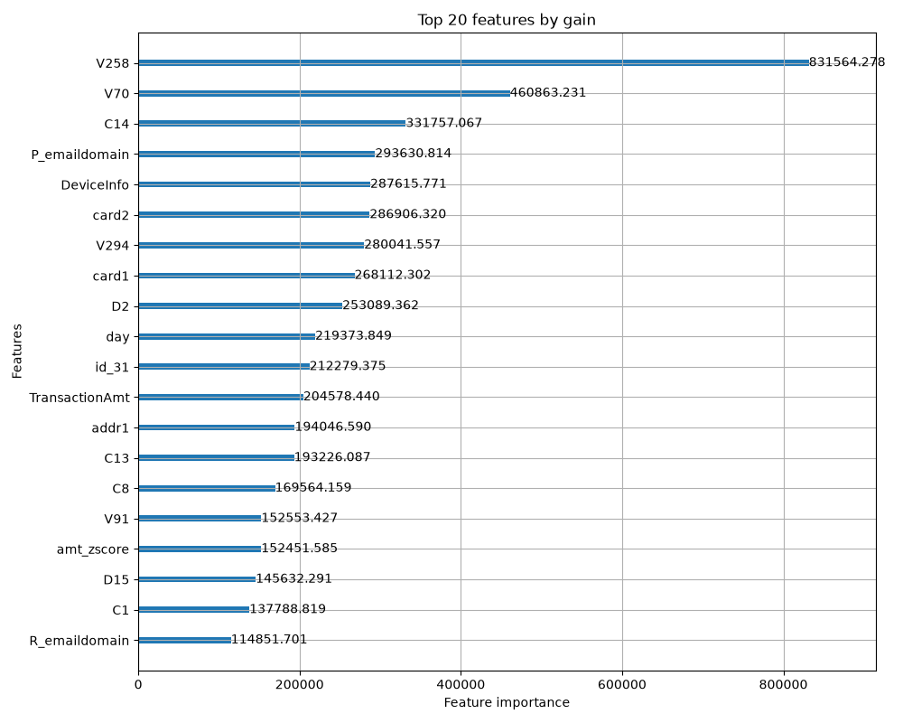

# Fraud Investigation System

ML fraud detection + LLM investigation agent, built on the IEEE-CIS dataset.

**Live demo:** https://claude.ai/artifact/BRfLy1r4EtgM4RxQtxqAgo



## What this is

A two-stage fraud detection pipeline. A LightGBM model scores every transaction; an LLM agent investigates the ones it flags, using tools to pull account history and linked-transaction evidence before submitting a verdict. The goal is to combine the speed of ML scoring with the judgment an investigation needs.

## Architecture

```
Transaction -> Feature Engineering -> LightGBM -> Risk Score
                                                     |
                              low risk ------------- high/medium risk
                           (auto-approve)                 |
                                                LLM Investigation Agent
                                                (tools: account history,
                                                 linked transactions)
                                                          |
                                                  Structured Verdict
```

## The ML layer

- **Data:** IEEE-CIS Fraud Detection (590,540 transactions, 3.5% fraud rate, ~400 features)
- **Model:** LightGBM, class-weighted for imbalance
- **Validation:** temporal split (train on earlier data, validate on later). A random split would leak future fraud patterns into training and overstate performance.
- **Metric:** PR-AUC, not ROC-AUC. With fraud this rare, ROC-AUC's false-positive rate is diluted by the huge pool of legitimate transactions and stays misleadingly high even when precision is poor. PR-AUC reflects what matters: when the model flags something, how often is it right.
- **Models compared:** Logistic Regression, Random Forest, Extra Trees, HistGradientBoosting, XGBoost, CatBoost, a PyTorch MLP, and Isolation Forest (unsupervised baseline). LightGBM and CatBoost led.



## The SHAP -> LLM handoff

For the highest-risk transactions, SHAP values decompose the score into per-feature contributions. Many of the dataset's most predictive columns (V1-V339, C1-C14, D1-D15) are anonymised by the data provider. Rather than inventing explanations for them, the handoff describes each as a value and a percentile against the training distribution ("higher than 99% of training transactions") and says so explicitly when a feature's meaning is unknown. The agent's system prompt enforces the same rule: never invent what an anonymised feature measures.

## The investigation agent

Given a flagged transaction's SHAP evidence, the agent can call three tools before submitting a verdict:

- `get_transaction_details`: raw transaction fields
- `get_account_history`: prior transactions from the same proxy account (the dataset has no user ID, so `card1 + addr1` stands in)
- `find_linked_transactions`: other accounts sharing a device, card, or address

Design constraints:

- **No look-ahead.** Every tool only sees transactions before the flagged one.
- **Delayed labels.** A prior transaction's fraud label only counts once it is 7 days old, matching how real chargebacks arrive late.
- **Untrusted input.** Device strings and email domains come from the transaction itself and could be attacker-controlled, so the prompt treats them as data, never instructions.

Built two ways: a plain tool-calling loop, and the same logic as an explicit LangGraph state machine. Both are provider-pluggable (Claude, Gemini, Groq) via a shared tool-spec format converted to each provider's native schema at call time.

## Finding: where the agent earns its place

Across 48 successfully investigated cases (2 of 50 failed on free-tier quota limits and are excluded), the agent was correct on all 11 decisive verdicts it issued, escalating the remaining 37 to human review rather than guess.

Across all 8 cases where a bare 0.5 score threshold would have been wrong (7 false alarms and 1 missed fraud), the agent never repeated a single one of those mistakes. It either decided correctly or escalated.

The case for the LLM layer is not higher raw accuracy on easy cases. It is avoiding the specific wrong-but-confident calls a blind threshold makes, in either direction.

*Small sample (48 cases); treat this as an early signal, not a benchmark.*

## What's not yet built

- **Scale:** 50 cases run, 48 investigated, 2 pending a retry once free-tier quota resets. Next: go past 50 for a representative sample.
- **Feedback loop:** built (dashboard capture -> `feedback_loop.py` -> corrected training labels). The mechanism matters more than the result on this dataset, since IEEE-CIS already has ground-truth labels. It matters on real, unlabeled transactions, where an analyst's correction is the label.
- **Larger, unlabeled dataset:** the real test of the feedback mechanism.
- **End-to-end loop closure:** nothing yet automatically retrains, redeploys, and confirms performance improved. That cycle is still manual.
- **Backend:** the live demo calls an LLM directly from the browser against cached evidence. A production version would need a real scoring endpoint.

## The dashboard

Browse every case's SHAP evidence and the agent's full tool-call trail, replay an investigation live, and (with edit access) leave analyst feedback that feeds back into retraining.

## Setup

> TODO: add install steps and run order. Files in this repo:
>
> - `ieee_cis_pipeline.py`: feature engineering and model training
> - `model_comparison.py`: compares the models listed above
> - `investigation_agent.py`: plain tool-calling agent loop
> - `investigation_agent_langgraph.py`: same agent as a LangGraph state machine
> - `feedback_loop.py`: turns analyst feedback into corrected labels
> - `Fraud Investigation Agent.html`: the dashboard

The IEEE-CIS data is not included in this repo. Download it from the [Kaggle competition page](https://www.kaggle.com/c/ieee-fraud-detection/data) and accept its terms.

API keys are read from environment variables (see `.env.example`). Never commit a real `.env`.
